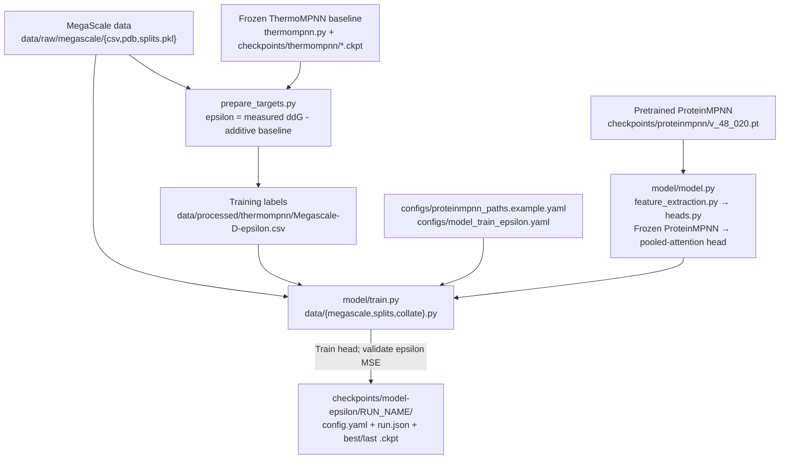

# Mutation prediction



Predict double-mutant stability changes using a pretrained single-mutant
ThermoMPNN baseline and our ProteinMPNN-based epsilon model.

```text
WT structure + substitutions
  ├─ ThermoMPNN → ΔΔG₁ + ΔΔG₂ = additive baseline
  └─ ProteinMPNN → mutation features → pooled-attention head → ε̂

Predicted double-mutant ΔΔG = additive baseline + ε̂
```

The training target is `epsilon_target = true_ddg_12 - baseline_ddg`.
It includes errors in the predicted single-mutant baseline as well as epistasis.
Targets and final predictions use kcal/mol, positive for destabilization.

## Quick start

**Start with [Set up the ThermoMPNN-D no-augmentation data](docs/setup.md).**
It is the complete first-run guide, with copyable commands in execution order:

1. Install the environment with `uv sync --extra tracking`.
2. Download the published MegaScale and PTMUL-D archives using `curl`, verify
   checksums, and extract them to the configured paths.
3. Download the single-mutant ThermoMPNN baseline and vanilla ProteinMPNN weights.
4. Submit the label-preparation job and wait for its split audit to pass.
5. Train, then evaluate a validation-selected checkpoint on both test sets.

The default workflow preserves the paper's Table 1 no-data-augmentation
memberships: **85,253 / 10,282 / 18,574** MegaScale train/validation/test mutations,
plus **536 PTMUL-D mutations for external testing only**. It requires no setup
notebook, split regeneration, or Rosetta augmentation data.

Submit jobs from the repository root. The main preparation, training, and
evaluation jobs use your submission directory; override `--account` if your
Slurm allocation differs from the default `def-sushant`.

Further details:

- [Label generation and single-mutant inference](docs/thermompnn_inference.md).
- [Model composition and training options](docs/model.md).
- [Evaluation, new model adapters, and cluster test commands](docs/evaluation.md).
- [Job monitoring, logs, and W&B sync](slurm/README.md).

### Record W&B runs offline on Narval

On a Narval login node, prepare the environment from the repository root and
authenticate for later uploads:

```bash
uv sync --extra tracking
uv run --extra tracking wandb login
```

If W&B reports that you're already logged in as the intended account, you can
use those saved credentials when you sync.

In the Slurm job, run from the same repository root on shared storage. Set
`project` in the training YAML to enable tracking and `name` to a short label
you can recognize in the dashboard.

```bash
WANDB_MODE=offline WANDB_DIR="$PWD" uv run --offline --no-sync mutation-prediction \
  configs/proteinmpnn_paths.example.yaml configs/model_train_epsilon.yaml
```

Each launch writes a separate `wandb/offline-run-*` directory. The W&B display
name includes the config's `name`, the Slurm job ID when available, and a unique
run ID. W&B Config stores the resolved run settings under `run_config` and the
Slurm ID under `slurm_job_id`. Keep credentials out of the YAML because the
resolved values will be uploaded when you sync.

`train_loss_step` records training loss during the epoch. Set
`training.log_every_n_steps` in the YAML to log less often. Epoch metrics
such as `train_epsilon_mse` and `val_epsilon_mse` appear when their respective
loops finish. Each launch automatically gets its own directory under
`training.output_dir`, named exactly like the W&B run, for example
`checkpoints/model-epsilon/pooled_attention_epsilon-slurm-12345-a1b2c3d4e5f6/`.
In the W&B run's Overview/Summary, `checkpoint_dir`, `best_checkpoint_path`,
`last_checkpoint_path`, and `best_checkpoint_score` identify the saved files
and validation score. These fields update after checkpoint saves and sync with
offline runs. The directory also contains `config.yaml` and `run.json`; the
checkpoint itself saves the run identity in its configuration.
A `--resume` launch gets a new run ID and directory, records `resumed_from`,
and selects the best checkpoint among the resumed launch's validation results.

After the job exits, preview and upload unsynced runs from the login node:

```bash
uv run --extra tracking wandb sync --dry-run
uv run --extra tracking wandb sync
```

Pass `wandb/offline-run-<timestamp>-<id>` to sync a single run. Add
`--entity <account-or-team> --project <project>` to override the destination.
For older `wandb/run-*` directories recorded in online mode, add
`--include-online`. If you set `WANDB_DIR` to another shared parent directory,
pass the run directories under that parent's `wandb/` folder explicitly.
Keep the offline run directories until you've checked the synced metrics and
config in the dashboard.

## Where to start reading

| Location | Purpose |
| --- | --- |
| [thermompnn.py](src/mutation_prediction/thermompnn.py) | Frozen single-mutant baseline API and CLI. |
| [prepare_targets.py](src/mutation_prediction/prepare_targets.py) | Cached single predictions, additive baseline, epsilon labels, and provenance. |
| [data/](src/mutation_prediction/data/) | MegaScale dataset, collator, mutation records, and download. |
| [model/](src/mutation_prediction/model/) | ProteinMPNN feature extractor, your head, composition, and training. |
| [evaluate.py](src/mutation_prediction/evaluate.py) | Fixed-test-set comparisons, model adapters, predictions, and paper-reference metrics. |
| [configs/](configs/) | Epsilon training plus optional measured-ddG comparison. |
| [thermompnn_d_vendor/](src/mutation_prediction/thermompnn_d_vendor/) | Retained upstream architecture; start elsewhere when learning this project. |
| [notebooks/](notebooks/) | Optional exploration, outside the supported pipeline. |
| [tests/](tests/) | Inference, label conventions, training/resume, and tensor contracts. |

Read `model/feature_extraction.py` → `model/heads.py` → `model/model.py` →
`model/train.py` to understand your model. Detailed [tensor shapes](docs/tensor_shapes.md)
and [upstream provenance](src/mutation_prediction/thermompnn_d_vendor/README.md) are separate references.

## Optional tools

```bash
uv sync --extra tracking --extra notebooks
uv run marimo edit notebooks/try_model.py
uv run pre-commit install
```

Run notebooks in the project environment, not an isolated notebook sandbox.
They are optional exploration; follow the [setup guide](docs/setup.md) to obtain
data and weights first.
Set `project` in the training YAML to enable W&B logging.
`configs/model_train_epistatic.yaml` retains the measured-ddG comparison;
its legacy training targets use the opposite sign from the epsilon workflow.
Rosetta augmentation, upstream ThermoMPNN training, the Siamese model, and
legacy benchmark inference have been retired.

The pre-commit hook applies Ruff's safe fixes and formatting to staged Python
files, then stages its changes. Remaining lint errors do not block the commit.
Run it manually with `uv run pre-commit run --all-files`.

Inside a cluster compute allocation, run the test suite with
`.venv/bin/python -m unittest discover -s tests -v`.

